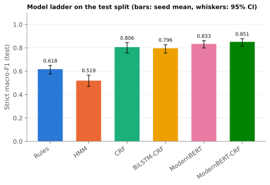
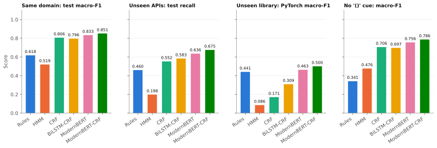
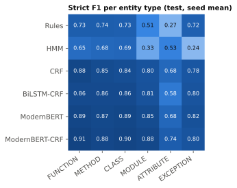
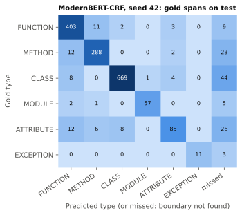

# APILens

Named-entity recognition of Python API mentions in official library documentation.
COE025 Natural Language Processing, Project 2 (sequence labeling), İstinye University.

| | |
|---|---|
| **Task** | Token classification: find every API mention in a sentence and type it as FUNCTION, METHOD, CLASS, MODULE, ATTRIBUTE or EXCEPTION (IOB2, 13 labels). |
| **Data** | 16,796 sentences and 19,504 mentions built by our own pipeline from the docs of NumPy, SciPy, pandas, scikit-learn and Matplotlib (train/dev/test) and PyTorch (held-out library). Frozen as git tag `data-v2`. |
| **Labels** | Not hand-made. The position comes from the doc authors' Sphinx/MyST roles, the type from each library's version-pinned `objects.inv` inventory. |
| **Models** | Rules, HMM, CRF, BiLSTM-CRF (all decoded with one shared Viterbi), ModernBERT with a softmax or a CRF head. |
| **Best result** | ModernBERT-CRF: test macro-F1 0.851 ± 0.011 (3 seeds); 0.500 on the unseen PyTorch docs. |
| **Application** | `src/hallucination_check.py` flags API names in an LLM answer that do not exist in the library inventories. |

## Why it is new

- **Task.** Existing code-entity NER work tags code or Stack Overflow posts. APILens tags API names in the prose of official documentation and separates the six kinds of Python objects a reader must tell apart (`DataFrame.merge()` is a METHOD, `pandas.merge()` a FUNCTION).
- **Data.** No public dataset exists for this; we built it. Labels are objective because both the span and the type come from upstream metadata, not from our judgment; anything that cannot be resolved uniquely is dropped instead of guessed.
- **Evaluation.** Four test regimes probe different abilities: in-distribution test, test API targets never seen in training, a whole unseen library (PyTorch), and test without the "()" that Sphinx appends to functions and methods.

## The task

One sentence from the scikit-learn docs, tokenized by `src/data_io.tokenize()`:

```
The   function cohen_kappa_score (          )          computes Cohen ' s kappa statistic .
O     O        B-FUNCTION        I-FUNCTION I-FUNCTION O        ...
```

| Type | Example from the data |
|---|---|
| FUNCTION | `cross_validate()` |
| METHOD | `DataFrame.to_json()` |
| CLASS | `LogisticRegressionCV` |
| MODULE | `scipy.sparse.csgraph` |
| ATTRIBUTE | `numpy.random.BitGenerator.seed_seq` |
| EXCEPTION | `FileNotFoundError` |

Evaluation is strict entity-level IOB2: a mention counts only if both boundaries and the type are right.

## Dataset

Full details, every rule and every count: [`docs/preprocessing.md`](docs/preprocessing.md). All numbers below come from [`data/processed/stats.json`](data/processed/stats.json).

**Sources.** Documentation source files at pinned release tags (NumPy v2.5.4, SciPy v1.18.0, pandas v3.1.0, scikit-learn 1.9.1, Matplotlib v3.11.2, PyTorch v2.14.1) and the matching `objects.inv` inventories, plus the Python 3.15 inventory. Tags, commits and URLs are in `data/raw/SOURCES.json`; `data/raw/checksums.txt` holds the SHA-256 of every raw file.

**Pipeline.** `scripts/download_data.py` fetches the pinned sources. `scripts/build_dataset.py` renders reST/MyST as the website shows it, resolves each role target against the inventories like Sphinx does, splits sentences, converts spans to IOB2 and applies eight drop rules in a fixed order (markup residue, unresolved target, ambiguous target, entity boundary inside a token, unlabeled API literal, length, low alphabetic ratio, duplicates). `--check` rebuilds everything in a temporary folder and compares SHA-256 hashes byte for byte.

**Splits.** Whole documents are assigned to train/dev/test, so no page appears in two splits (`shared_doc_paths` = 0). All PyTorch sentences form the held-out set. `test_noparen` is the test set with the "()" removed from FUNCTION and METHOD spans.

| Split | Sentences | Tokens | Mentions |
|---|---|---|---|
| train | 12,486 | 271,739 | 14,768 |
| dev | 2,080 | 44,402 | 2,363 |
| test | 1,630 | 34,210 | 1,695 |
| heldout (PyTorch) | 600 | 15,131 | 678 |

Mentions by type: CLASS 7,904, FUNCTION 4,929, METHOD 4,886, ATTRIBUTE 990, MODULE 664, EXCEPTION 131. 248 of the 1,695 test mentions (14.6%) have a target never seen in train.

**Data versions.** `data-v1` dropped most pandas sentences because a `{{ header }}` template that sets the current module was not expanded, and most scikit-learn changelog lines because of `|Fix|`-style badges. `data-v2` renders both as the website does, with no change to any drop rule, threshold, seed or split ratio; all reported runs use `data-v2`.

**Label audit.** 150 test sentences (seed 7, at least 15 mentions per type where available; EXCEPTION has 14) were checked by hand against the documentation; 50 of them were checked again by a second annotator without seeing the first annotator's answers. The test sentences were read only after every dev-based choice and every final run. From [`results/label_audit.csv`](results/label_audit.csv) and [`results/label_audit_second.csv`](results/label_audit_second.csv) (`python src/build_benchmark.py --audit-report --second results/label_audit_second.csv`):

| Measure | Value |
|---|---|
| Marked spans with a wrong boundary or type | 6 / 169 = 3.6% |
| Sentences with at least one wrong span | 6 / 150 = 4.0% |
| API mentions the authors did not mark | 15.3 per 100 sentences |
| Agreement on "all marked spans are correct" (50 shared sentences) | 50 / 50; Cohen's κ undefined, because both annotators answered "yes" for every shared sentence |
| Agreement on the number of unmarked mentions (50 shared sentences) | 42 / 50; the second annotator found 15 unmarked mentions where the first found 6 |

The marked spans are reliable; the main weakness is recall of the labels: some API names are not marked by the doc authors, so they appear as `O`, and the unmarked-mention rate is a lower bound.

## Models

Every model trains on train, chooses its settings on dev only, and is evaluated once on the four final splits. HMM, CRF and BiLSTM-CRF decode with the same `src/viterbi.py` (log-space, tested against brute force); the CRF layer of BiLSTM-CRF and ModernBERT-CRF is written from scratch (forward algorithm tested against brute-force log-sum-exp).

| Model | Script | What it is | Pre-trained | Parameters | Hardware | Train time (s) |
|---|---|---|---|---|---|---|
| Rules | `src/rule_baseline.py` | surface-form rules on token shape and "()" | no | 0 | CPU | 0 |
| HMM | `src/train_hmm.py` | first-order HMM, add-k smoothing (k = 0.01 on dev), word-shape classes for rare words | no | 107,211 | CPU | 3 |
| CRF | `src/train_crf.py` | linear-chain CRF (sklearn-crfsuite), hand-written form and context features (c1 = 0.01, c2 = 0.5 on dev) | no | 58,857 | CPU | 162 |
| BiLSTM-CRF | `src/train_bilstm_crf.py` | word embeddings + char CNN + BiLSTM + CRF layer | no | 1,399,348 | CPU (Apple M) | 477 |
| ModernBERT | `src/train_transformer.py --head softmax` | `answerdotai/ModernBERT-base`, softmax on first sub-tokens | yes | 149,614,861 | Tesla T4 | 493 |
| ModernBERT-CRF | `src/train_transformer.py --head crf` | same encoder + our CRF layer | yes | 149,024,464 | Tesla T4 | 560 |

ModernBERT uses lr 8e-5, chosen once on dev from {3e-5, 5e-5, 8e-5} with seed 42, 5 epochs, fp16 on the T4 (no bf16 support), max length 256 sub-tokens (the longest sentence needs 140; the script stops if any sentence would be truncated). Neural models run seeds 13, 42 and 2026; each model's three seeds ran on one device, and running the same seed twice gives identical scores. Parameter counts and times are seed 42 (or the single run) from `results/<model>_seed<seed>.json`; times are not comparable across hardware.

## Results

All numbers come from [`results/benchmark.csv`](results/benchmark.csv), produced by `python src/build_benchmark.py --final`, which recomputes every stored score from the prediction files and stops on any mismatch. Macro-F1 is the unweighted mean over the entity types with gold support in that split (strict, IOB2); ± is the standard deviation over seeds; the interval is a 95% bootstrap CI over test sentences.

| Model | Seeds | Test macro-F1 | 95% CI | Test micro-F1 | Heldout macro-F1 | Test no-"()" macro-F1 | Unseen-target recall | Invalid IOB2 rate |
|---|---|---|---|---|---|---|---|---|
| Rules | 1 | 0.618 | [0.575, 0.649] | 0.649 | 0.441 | 0.341 | 0.460 | 0.0000 |
| HMM | 1 | 0.519 | [0.469, 0.567] | 0.642 | 0.086 | 0.476 | 0.198 | 0.0000 |
| CRF | 1 | 0.806 | [0.755, 0.844] | 0.841 | 0.171 | 0.706 | 0.552 | 0.0000 |
| BiLSTM-CRF | 3 | 0.796 ± 0.018 | [0.756, 0.827] | 0.842 | 0.309 ± 0.046 | 0.697 ± 0.019 | 0.583 | 0.0000 |
| ModernBERT | 3 | 0.833 ± 0.009 | [0.799, 0.861] | 0.869 | 0.463 ± 0.014 | 0.756 ± 0.006 | 0.636 | 0.0239 |
| ModernBERT-CRF | 3 | **0.851 ± 0.011** | [0.814, 0.878] | **0.885** | **0.500 ± 0.020** | **0.786 ± 0.012** | **0.675** | 0.0000 |




**What the results say**

1. **Pre-training plus a CRF head leads.** ModernBERT-CRF is best in-distribution and on every other regime. Its CRF head adds about 0.02 test macro-F1 over ModernBERT and removes all invalid IOB2 output (0.0239 → 0).
2. **An unseen library is the real challenge.** Every model loses a lot on PyTorch. The learned models without pre-training fall below the hand-written rules (Rules 0.441 vs CRF 0.171, BiLSTM-CRF 0.309); only ModernBERT beats them.
3. **Models lean on "()".** Removing the parentheses costs every model test macro-F1, from 0.043 (HMM) and 0.065 (ModernBERT-CRF) up to 0.277 for the Rules baseline, which depends on them by design.
4. **Unseen targets.** Recall on test mentions whose target never occurs in train is 0.675 at best.

**Ablations** ([`results/ablations.csv`](results/ablations.csv), single seed):

| Ablation | Test macro-F1 (full → ablated) | Heldout macro-F1 (full → ablated) |
|---|---|---|
| BiLSTM-CRF without char CNN (`--no-char`) | 0.791 → 0.768 | 0.330 → 0.187 |
| BiLSTM with softmax instead of CRF (`--softmax`) | 0.791 → 0.793 | 0.330 → 0.189 |
| CRF without ±2 context features (`--no-context`) | 0.806 → 0.771 | 0.171 → 0.171 |
| HMM without IOB2 masks (`--no-mask`) | 0.519 → 0.519 | 0.086 → 0.086 |

Character features and the CRF layer matter little in-distribution but a lot on the unseen library. The HMM ablation changes nothing: with k = 0.01 the smoothed I-X transitions that the mask forbids are already too improbable for Viterbi to choose, so the predictions are identical token for token.



## Error analysis

Full write-up: [`results/error_analysis.md`](results/error_analysis.md), from `python src/build_benchmark.py --final --errors` on ModernBERT-CRF, seed 42, test. Boundary errors are almost absent; the errors are wrong types (72), missed mentions (109) and extra predictions (153). Sixty sampled errors were classified by written rules ([`results/error_labels.csv`](results/error_labels.csv)):

- **Most "extra" predictions are right.** 12 of 20 sampled spurious predictions are real API names the authors did not mark, so measured precision understates the model; this matches the label audit.
- **Function vs method** is the main type confusion; part of it is label noise ("the filled() method" is typed FUNCTION by the inventory link) and part is names that exist as both.
- **The "()" cue:** classes written with "()" (`coo_array()`) are predicted as FUNCTION, consistent with the drop on `test_noparen`.



## Application demo

`src/hallucination_check.py` tags a text, for example an LLM answer, with a saved BiLSTM-CRF checkpoint and looks every predicted API name up in the pinned inventories (exact name, then a unique suffix). It reports FOUND, NOT FOUND or AMBIGUOUS and whether the predicted type agrees with the inventory. It trains nothing and writes nothing.

```bash
python src/train_bilstm_crf.py --final --seed 42      # writes checkpoints/bilstm_crf_seed42.pt
python src/hallucination_check.py answer.txt checkpoints/bilstm_crf_seed42.pt
```

On an answer that mixes real calls with invented ones, `DataFrame.smart_merge()` and `numpy.fast_unique()` come back NOT FOUND while `DataFrame.merge()`, `pandas.concat()`, `numpy.unique()`, `KeyError` and `numpy.ndarray.reshape()` are found with the right type.

## Limitations

- **Labels follow the authors' markup.** Unmarked API names are `O` (15.3 per 100 audited sentences, a lower bound), which lowers measured precision and recall.
- **Inventory types sometimes contradict the text** (ufuncs and class aliases are inventory "data", so ATTRIBUTE).
- **Changelog-heavy data:** 9,623 of 16,796 sentences come from release notes, whose short bug-fix lines differ from tutorials.
- **EXCEPTION is rare** (131 mentions), so its per-type F1 and the macro average are noisy.
- **Search edges:** ModernBERT's lr (8e-5), the HMM's k (0.01) and the CRF's c2 (0.5) were each chosen at the edge of their grid, and every ModernBERT run peaked at its last epoch; we kept the one-shot choices instead of searching again after seeing them.
- **Single seed** for ablations, deterministic models and the error analysis.
- **Decoding:** crfsuite decodes without the IOB2 masks (invalid IOB2 rate 0.0005 on dev, 0 on the final test splits).
- **Hardware differs** between model families, so training times are only indicative.
- **Final-test scope:** test sentences were read only after all dev-based choices and final runs, so no iterative test feedback was used; the conclusions still rely on one frozen test set.

## Repository structure

| Path | Contents |
|---|---|
| `data/raw/<library>/` | Pinned documentation sources, upstream `LICENSE` and `conf.py` (written only by `scripts/download_data.py`). |
| `data/raw/inventories/` | Version-pinned `objects.inv` files, including the Python standard library. |
| `data/raw/SOURCES.json`, `checksums.txt` | Tags, commits and inventory URLs; SHA-256 of every raw file. |
| `data/processed/` | `train/dev/test/heldout/test_noparen.jsonl` and `stats.json` (written only by `scripts/build_dataset.py`). |
| `docs/preprocessing.md` | Dataset documentation: sources, pipeline, every drop rule with its count, schema, limitations. |
| `scripts/download_data.py` | Downloads and pins the raw sources and inventories. |
| `scripts/build_dataset.py` | Builds the dataset; `--check` verifies byte-for-byte determinism. |
| `src/data_io.py` | Label set, tokenizer, IOB2 conversion, schema validation, protected split loading. |
| `src/viterbi.py` | Shared log-space Viterbi and IOB2 transition/start masks. |
| `src/metrics.py` | The only source of numbers: strict entity metrics, slices, bootstrap CIs, Cohen's κ, output writers. |
| `src/rule_baseline.py`, `train_hmm.py`, `train_crf.py` | Rules, HMM and CRF. |
| `src/train_bilstm_crf.py` | BiLSTM-CRF with our CRF layer (also used by the transformer). |
| `src/train_transformer.py` | ModernBERT with softmax or CRF head, one-time lr sweep. |
| `src/build_benchmark.py` | Verifies every run and writes the benchmark, ablations and figures; `--sample-audit`, `--audit-report`, `--errors`. |
| `src/hallucination_check.py` | Application demo. |
| `tests/` | Unit tests for every module (`fixtures/mini.jsonl` is a hand-written mini dataset). |
| `results/<model>_seed<seed>.json` | One file per run: config, hardware, parameters, best epoch, train time, metrics per split. |
| `results/preds/` | Predictions of every run on every final split. |
| `results/benchmark.csv`, `ablations.csv`, `figures/` | Aggregated results and the four figures. |
| `results/label_audit.csv`, `label_audit_second.csv` | Label audit: first annotator (150 sentences) and second annotator (50 shared sentences). |
| `results/error_analysis.md`, `error_labels.csv` | Error analysis and the classification of the 60 sampled errors. |
| `contributions/` | One record per team member. |

## Reproducing

```bash
# 1. Install the CUDA build of PyTorch for your GPU first (https://pytorch.org/get-started/locally/); it is not pinned here.
pip install -r requirements.txt
python -m pytest -q

# 2. Data (already in the repo; this rebuilds and verifies it)
python scripts/download_data.py
python scripts/build_dataset.py --check

# 3. Final runs (without --final a script trains on train, reports dev and writes nothing)
python src/rule_baseline.py --final
python src/train_hmm.py --final && python src/train_hmm.py --final --no-mask
python src/train_crf.py --final && python src/train_crf.py --final --no-context
for seed in 13 42 2026; do
  python src/train_bilstm_crf.py --final --seed $seed
  python src/train_transformer.py --head softmax --final --seed $seed --precision fp16
  python src/train_transformer.py --head crf --final --seed $seed --precision fp16
done
python src/train_bilstm_crf.py --final --seed 42 --no-char
python src/train_bilstm_crf.py --final --seed 42 --softmax

# 4. Benchmark, audit report and error analysis
python src/build_benchmark.py --final
python src/build_benchmark.py --audit-report --second results/label_audit_second.csv
python src/build_benchmark.py --final --errors
```

Use `--precision bf16` on GPUs that support it. Scores on other hardware can differ slightly from ours; the same seed on the same device reproduces them exactly.

## Licenses

Code and documentation: MIT. The data in `data/raw/` and the derived `data/processed/` keep the licenses of their sources (BSD-3-Clause for NumPy, SciPy, pandas, scikit-learn and PyTorch; the Matplotlib license agreement; the PSF License for the Python inventory). See [`LICENSE`](LICENSE).

## Citations

- Warner et al., *Smarter, Better, Faster, Longer: A Modern Bidirectional Encoder for Fast, Memory Efficient, and Long Context Finetuning and Inference* (ModernBERT), 2024.
- Lample et al., *Neural Architectures for Named Entity Recognition*, NAACL 2016 (BiLSTM-CRF).
- Ma and Hovy, *End-to-end Sequence Labeling via Bi-directional LSTM-CNNs-CRF*, ACL 2016 (char CNN).
- Lafferty, McCallum and Pereira, *Conditional Random Fields*, ICML 2001.
- Nakayama, *seqeval*, 2018; Okazaki, *CRFsuite*, 2007.
- Sphinx `objects.inv` inventories read with *sphobjinv*.

## Team

| Member | Role |
|---|---|
| Mert Tomak | Coordination, BiLSTM-CRF, ModernBERT, application demo; label audit and error analysis (taken over) |
| Görkem Veysel Göksu | Data pipeline and dataset; second annotator |
| Cemal Batuhan Baş | Viterbi, rule baseline, HMM, CRF |
| Zeynep Çelik | Metrics, benchmark builder and figures, audit tooling |
| Yağız Efe Gökçe | Presentation, README review |

Each member's record, with how they used and verified a coding assistant, is in [`contributions/`](contributions/).
